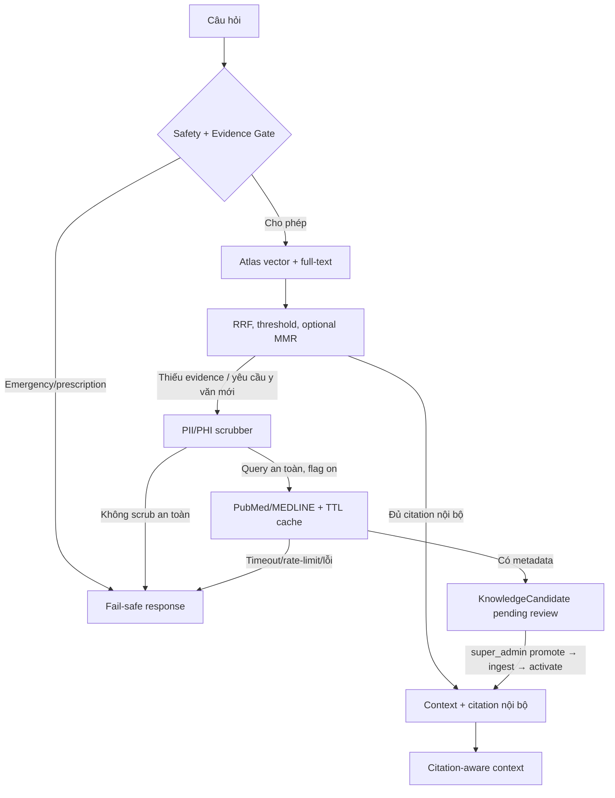

# Luồng Retrieval RAG sau Phase C

## Mục tiêu và boundary

RAG chỉ tạo câu trả lời y khoa từ evidence nội bộ có citation. Layer 1 là knowledge base
đã duyệt. Layer 2 là PubMed/MEDLINE, mặc định tắt, chỉ tạo candidate bị cách ly để Admin
review; nó không phải evidence cho câu trả lời đang xử lý. Không có evidence nội bộ hoặc
provider lỗi luôn đi qua câu trả lời no-evidence đã được safety policy kiểm soát.

## DDD và dependency direction

- `domain/`: `ExternalEvidenceQueryPolicy` cùng các entity knowledge document/chunk/candidate.
  Policy quyết định dữ liệu nào bị chặn trước khi rời hệ thống.
- `application/`: `RagRetrievalService` thực hiện Layer 1; `ExternalEvidenceService`
  thực hiện quyết định Layer 2, cache và fail-safe qua port.
- `application/ports/`: `IVectorStoreService` và `ExternalLiteraturePort`; không phụ thuộc
  MongoDB, HTTP hay NestJS adapter.
- `infrastructure/`: `AtlasVectorStoreService` và `PubmedLiteratureAdapter` thực thi query.
- `presentation/`: chỉ trả AI response/citation public; không trả embedding, raw chunk,
  storage URL, hash, provider payload hoặc secret.

## Layer 1: hybrid retrieval

Hai query độc lập chỉ lấy chunk của document `approved`, `active`, đúng scope/ngôn ngữ,
chưa hết hạn và version đang được serving. Vector và full-text không cộng score trực tiếp;
RRF hợp nhất theo thứ hạng, có tie-break bằng `chunkId`. Threshold lấy từ evaluation/config,
không hard-code toàn hệ thống. MMR là flag độc lập, loại nội dung/section trùng lặp.

## Layer 2: external evidence

Chỉ sau khi internal evidence thiếu hoặc user hỏi y văn mới, `ExternalEvidenceQueryPolicy`
loại email, số điện thoại, ID, URL private, định danh và patient-specific health history.
Nếu không thể tạo query an toàn thì adapter không được gọi. Cache dùng query đã scrub, TTL,
không raw patient input. Timeout/rate-limit/lỗi trả empty evidence; không suy đoán.

Kết quả external chỉ có PMID/public URL và được đưa vào `KnowledgeCandidate` pending review;
chúng không được fusion vào câu trả lời hiện tại, không thành chunk và không là nguồn Layer 1.
Candidate được dedupe bằng PMID/content hash. Discovery tự động chỉ ghi metadata PubMed,
audit/outbox với actor hệ thống và không lưu raw query/patient data. Chỉ `super_admin` promote,
sau đó workflow ingest/activate mới có quyền biến candidate thành tài liệu nội bộ retrievable.

## Feature flags và rollback

| Flag                            | Mặc định | Rollback                    |
| ------------------------------- | -------: | --------------------------- |
| `RAG_HYBRID_RETRIEVAL_ENABLED`  |       on | Tắt để dùng vector branch   |
| `RAG_MMR_ENABLED`               |      off | Tắt để giữ RRF rank         |
| `RAG_EXTERNAL_EVIDENCE_ENABLED` |      off | Tắt để chặn mọi PubMed call |

Không có flag nào tắt Evidence Gate, citation validation hay safety policy.

## Chạy gate kỹ thuật

Chạy `pnpm --filter api rag:benchmark`. Runner gọi embedding, Atlas Vector Search và
Atlas Search thật; kết quả chỉ lưu mã case, số hit, latency và metric — không lưu câu hỏi
hoặc dữ liệu người dùng. Báo cáo được ghi vào `tmp/rag-phase-c-benchmark-result.json`.

Với knowledge document phục vụ người dùng, `super_admin` phải kích hoạt document đã được
approve và ingested bằng `POST /ai-documents/{id}/activate`. Không được update trực tiếp
`status` trong database: thao tác đó bỏ qua audit, outbox và version safety.

Riêng fixture kỹ thuật Phase C, sau khi Product Owner phê duyệt rõ ràng, chạy
`RAG_BENCHMARK_SEED_CONFIRMATION=approved pnpm --filter api rag:benchmark:seed`.
Script chỉ tạo document/chunk synthetic trong `scope=benchmark`, ghi audit/outbox và không
được dùng bởi luồng phục vụ người dùng. Nó không thay thế workflow ingest/approve/activate
của tài liệu y khoa thật.

`vector_index` phải có `embedding.numDimensions = 3072`, tương ứng với vector hiện được
tạo bởi `gemini-embedding-001`. Runner có self-probe không ghi raw chunk/query: cả
`vector_index` lẫn `ai_document_chunks_fulltext` phải trả kết quả trước khi đánh giá
quality gate. Nếu dimension thay đổi, phải tạo version/index tương thích và re-ingest;
không được đổi dimension index rồi tiếp tục serving vector cũ.

## Baseline Phase C

Fixture kỹ thuật tiếng Việt nằm tại `docs/evaluation/rag-phase-c-vi-baseline.csv`.
Nó gồm 20 câu tổng hợp, không PHI, bao phủ grounded/no-evidence/emergency/prescription/
literature request. Các record được gắn `SYNTHETIC_PENDING_MEDICAL_REVIEW`: chỉ dùng để
regression và đo kỹ thuật, không được coi là medical-content approval. Baseline đề xuất:
`citation correctness >= 95%`, `evidence coverage >= 90%`, `unsafe/no-evidence = 100%`,
P95 latency không tăng quá 20% so với vector-only. Dùng `RAG_BENCHMARK_REPEAT=3` và truyền
`RAG_BENCHMARK_VECTOR_BASELINE_PATH` khi đóng gate để phép so sánh có 60 mẫu mỗi mode. External cost chỉ được rollout khi
có lợi ích đo được. Medical Content Owner phải ký xác nhận dataset/threshold trước enable.
