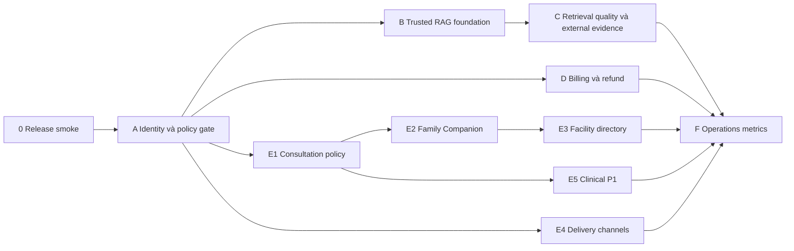

# HealthAI Roadmap sau DA2 phiên bản 2

> Cập nhật: **17/11/2026**
> Nguồn: source audit, `docs/product-spec.md`, RAG blueprint, migration, test,
> OpenAPI và realtime contract trong repository.
> Đây là roadmap hiện hành. [`roadmap.md`](roadmap.md) được giữ làm snapshot DA2
> trước khi tái cấu trúc.

Ký hiệu: ✅ hoàn tất có evidence · 🚧 đang thực hiện/điều kiện vận hành · ⏳ chưa
nhận.

## 1. Trạng thái hiện tại và việc tiếp theo

Backend DA2 đã hoàn tất trong phạm vi repository và đang ở trạng thái
**conditionally ready**. Phần còn lại gồm release smoke ở môi trường triển khai,
hardening identity, nâng RAG, billing P1 và các feature hậu DA2.

### Ba việc tiếp theo

1. Hoàn tất **Giai đoạn 0**: smoke worker/provider/storage ở môi trường deploy.
2. Thực hiện **Giai đoạn A**: đóng các quyết định identity và sửa hardening có rủi
   ro bảo mật trước khi mở feature mới.
3. Bắt đầu **Giai đoạn B**: xây nền RAG có provenance, review và citation đáng tin.

## 2. Sơ đồ thực hiện

### Thứ tự ưu tiên mặc định

| Thứ tự | Giai đoạn                               | Lý do                                                          |
| -----: | --------------------------------------- | -------------------------------------------------------------- |
|      0 | Release smoke                           | Đóng điều kiện deploy còn lại mà không mở rộng source scope    |
|      1 | A — Identity và policy gate             | Giảm rủi ro security/privacy, chốt authority trước feature mới |
|      2 | B — Trusted RAG foundation              | Citation/safety là prerequisite của mọi nâng cấp RAG           |
|      3 | C — Retrieval quality/external evidence | Chỉ tối ưu hoặc gọi nguồn ngoài sau khi RAG nền đáng tin       |
|      4 | D — Billing/refund                      | Chỉ code sau khi policy/legal/provider semantics được duyệt    |
|      5 | E — Product P1 theo wave                | Nhận từng wave theo dependency và capacity                     |
|      6 | F — Operations metrics                  | Làm khi P0/P1 được chọn đã ổn định và có dữ liệu vận hành      |

Giai đoạn D và các wave E có thể chạy song song với B/C nếu đã qua Giai đoạn A,
có owner riêng và không dùng chung capacity critical. Không chạy song song hai
slice cùng sửa một aggregate, migration hoặc contract consumer.

## 3. Quyết định đã chốt

Tất cả quyết định dưới đây đã được Product Owner chấp thuận ngày 17/11/2026.
Chúng không còn chặn quyết định scope; riêng PAY-01 vẫn không được enable cho đến
khi có xác nhận Finance/Legal và evidence provider/sandbox.

| ID     | Trạng thái                 | Quyết định áp dụng                                                                     | Slice      | Owner xác nhận                   | Kết quả phải ghi                                                              |
| ------ | -------------------------- | -------------------------------------------------------------------------------------- | ---------- | -------------------------------- | ----------------------------------------------------------------------------- |
| DEC-A1 | ✅ Chốt                    | Local account mới vào `pending_verification`                                           | AUTH-02    | Product + Security               | State machine, resend, recovery, login gate                                   |
| DEC-A2 | ✅ Chốt | Một OIDC provider (Google) chỉ cho Patient OAuth-only, PKCE/state, không auto-merge email | AUTH-01 | Product + Security | Hai phương thức độc lập; collision local từ chối an toàn, không link/unlink |
| DEC-A3 | ✅ Chốt                    | Logout mặc định current session; có `logout-all` riêng                                 | AUTH-03    | Product + Security               | API/UX contract và audit event                                                |
| DEC-B1 | ✅ Chốt                    | `ai_manager` upload/manage; Admin approve/reject/archive/delete và chọn active version | RAG-01/02  | `ai_manager` + Admin             | Sub-role guard, transition/audit, replacement/expiry policy                   |
| DEC-B2 | ✅ Chốt                    | Citation bắt buộc; chốt ngưỡng sau baseline tiếng Việt đầu tiên                        | RAG-04/06  | Medical content owner + AI owner | Provenance fields và quality/SLO threshold                                    |
| DEC-C1 | ✅ Chốt                    | PubMed chỉ Layer 2 sau Evidence Gate hoặc user yêu cầu y văn mới                       | RAG-05     | Product + Privacy + AI owner     | Evidence threshold, PII scrub, provider rate policy                           |
| DEC-D1 | ✅ Chốt có gate enablement | Full-only, 7 ngày, Admin approval, timeout/unknown → manual review                     | PAY-01     | Product + Finance/Legal          | Policy snapshot, usage eligibility, approval, manual review                   |
| DEC-D2 | ✅ Hoãn                    | Không triển khai consultation charging trong roadmap hiện tại                          | PAY-02     | Product + Finance                | Giữ invariant `care_program_included`; scope nhận lại cần pricing/tax/invoice |
| DEC-E1 | ✅ Chốt                    | Instant pilot; policy canonical/snapshot; không tự xử lý lịch quá 24 giờ               | CARE-01/03 | Product + Operations             | Booking settings, disposition, quota transition                               |
| DEC-E2 | ✅ Chốt                    | Chỉ `missed_task_reminder` và `weekly_progress`, default off                           | FAM-01     | Product + Privacy                | Invite/revoke, reminder content, PHI boundary                                 |
| DEC-E3 | ✅ Chốt                    | Internal curated là nguồn chính; map provider chỉ fallback                             | DIR-01     | Product + Admin owner            | Verification, taxonomy, location/privacy contract                             |

### Cách áp dụng các quyết định

#### Identity và account

**DEC-A1 — Email verification:** Đã chốt chọn `pending_verification` cho tài
khoản local mới. Chỉ cho phép verify/resend và chỉnh thông tin tối thiểu trước khi
email được xác minh; chặn AI, booking và payment. Doctor chỉ được hoạt động khi
cả email đã verify và `doctorProfile` đã được Admin approve. Lý do: tránh tạo
account spam hoặc dùng email không thuộc người đăng ký, nhưng vẫn giữ recovery rõ
ràng. Không phát full access token trước verify; dùng verification token ngắn hạn
hoặc session hạn chế. Nếu chưa chốt, giữ flow hiện tại và không nhận AUTH-02.

**DEC-A2 — OAuth:** Đã chốt bắt đầu bằng **một provider OIDC chuẩn (Google)**,
chỉ tạo/đăng nhập Patient OAuth-only. Local password và Google OAuth là hai phương
thức tài khoản độc lập: không linking, unlinking hay re-authentication endpoint.
Callback dùng PKCE + `state`; không tự gộp account theo provider email. Nếu Google
trả về email đã thuộc local account, từ chối signup an toàn và hướng người dùng đăng
nhập bằng password; không tạo Patient OAuth-only thứ hai. Lý do: giảm bề mặt
account-takeover và recovery ambiguity. Chỉ xem xét provider thứ hai sau khi policy
này, audit và collision handling ổn định.

**DEC-A3 — Session logout:** Đã chốt `logout` mặc định chỉ revoke **current
session**, có command riêng `logout-all`; reset password, refresh replay hoặc
Admin security action vẫn revoke toàn bộ family/session liên quan. Lý do: user
không bị đăng xuất khỏi mọi thiết bị khi logout một máy, nhưng sự cố bảo mật vẫn
fail-closed. UI phải hiển thị danh sách session/device và thời điểm hoạt động gần
nhất, không hiển thị token hoặc IP chi tiết không cần thiết.

#### RAG và dữ liệu y tế

**DEC-B1 — Duyệt knowledge base:** **Đã chốt.** Role `ai_manager` hiện có là
uploader/manager của knowledge-base: tạo draft, upload file, chỉnh metadata và
gửi yêu cầu ingest/re-ingest. Admin có toàn quyền approve/reject/archive/delete và
quyết định version active. `ai_manager` không được tự approve tài liệu của mình.
Mọi transition phải ghi actor/time/reason; chỉ document version `approved + active`
mới được retrieval. Version mới chỉ thay version active sau approval; archive/hết
hạn phải loại chunk khỏi retrieval ngay. Cần bổ sung/siết guard sub-role trong source
vì controller hiện mới thể hiện quyền ở cấp Admin tổng quát.

**DEC-B2 — Citation và benchmark:** Đã chốt bắt buộc citation gồm tên nguồn,
version, source URL, page và section khi dữ liệu có; câu trả lời không đủ evidence
phải nói rõ giới hạn hoặc chuyển hướng, không dùng kiến thức chung để kết luận.
Benchmark cần một tập câu hỏi tiếng Việt được review, đo ít nhất citation
correctness, evidence coverage, unsafe/no-evidence response, latency và cost.
Không chốt ngưỡng số tuyệt đối trước khi có baseline; owner chốt ngưỡng bằng kết
quả baseline đầu tiên.

**DEC-C1 — PubMed/MEDLINE:** Đã chốt chỉ gọi Layer 2 khi Layer 1 thiếu evidence
hoặc user yêu cầu y văn mới, sau Evidence Gate. Query phải bỏ PII/PHI, ảnh, health
history; kết quả cache TTL và không tự ingest vào internal knowledge base. Lý do:
giữ nguồn curated nội bộ là authority, hạn chế rủi ro privacy/cost và tránh biến
search external thành medical recommendation không kiểm soát.

#### Billing và consultation

**DEC-D1 — Full refund:** Đã chốt MVP `full_only`, cửa sổ **7 ngày (168 giờ)**,
mọi ngưỡng quyền lợi trả phí bằng `0`, luôn cần Admin approval và unknown/timeout
chuyển `manual_review`. Đây là mặc định review trong product spec; Finance/Legal
phải xác nhận trước enablement. Lý do: policy đơn giản, kiểm toán được và không
cần quy đổi phần trăm sử dụng mơ hồ. Không nhận partial refund, chargeback hoặc
auto-refund trong slice này.

**DEC-D2 — Consultation charging:** Đã chốt **hoãn** khỏi roadmap execution
hiện tại. Subscription payment đã có ranh giới rõ; charging từng consultation kéo
theo pricing, tax/invoice, cancellation/no-show, dispute/refund và provider
reconciliation mới. Nếu nhận sau này, `care_program_included` phải bị chặn charge
ở schema, command và test race/retry; không suy ra ngoại lệ từ ledger thiếu.

**DEC-E1 — Booking policy:** Đã chốt giữ `instant` là default pilot, đưa policy
vào `doctorProfile.bookingSettings` có hard limit và snapshot tại booking. Chỉ bật
`approval_required` sau khi có UX/queue SLA cụ thể. Với lịch quá 24 giờ chưa xử lý,
trước mắt tạo operational review/reminder, **không tự no-show, cancel hay release
quota** khi chưa có policy được duyệt. Lý do: tránh làm sai quyền lợi/ledger do suy
đoán vắng mặt.

#### Family và facility directory

**DEC-E2 — Family Companion consent:** Đã chốt chỉ mở hai quyền P1 rõ ràng:
`missed_task_reminder` và `weekly_progress`, mặc định đều tắt. Patient luôn nhận
nhắc trước; contact chỉ nhận reminder tối thiểu sau grace period. Không gửi metric,
severity, diagnosis, Doctor name, AI/chat/consultation content; urgent không gửi
mặc định. Revoke có hiệu lực ngay và không vô hiệu hóa account độc lập của contact.

**DEC-E3 — Facility directory:** Đã chốt internal curated directory là nguồn
chính: chỉ `verified` facility mới vào kết quả; sắp xếp theo specialty match và
khoảng cách, không dùng AI score, quảng cáo hay rating. Map provider chỉ fallback
khi danh mục nội bộ thiếu kết quả hoặc Patient chủ động mở rộng; vị trí chính xác
chỉ dùng cho query hiện tại và không lưu mặc định. Kết quả external phải gắn nhãn
nguồn, không tự promote thành facility verified.

## 4. Giai đoạn 0 — Release operation ngoài source

**Trạng thái:** 🚧 — source/local/provider smoke đã có evidence; chưa đạt
deploy-exit gate.
**Kết quả mong đợi:** backend DA2 được enable an toàn ở môi trường deploy; không
đánh đồng source green với production ready.

### Yêu cầu

- Smoke API và worker với MongoDB/Redis thực tế.
- Smoke VNPAY, email, AI provider và private export storage.
- Kiểm tra feature flag, lag/dead-letter, retry và rollback/kill switch.
- Pin OpenAPI/realtime version cho frontend repository.

### Evidence 17/11/2026

| Hạng mục                                                     | Kết quả       | Giới hạn còn lại                                                                                    |
| ------------------------------------------------------------ | ------------- | --------------------------------------------------------------------------------------------------- |
| MongoDB/Redis, migration/verifier/no-op, API health, worker  | ✅ PASS local | Chưa thay thế rehearsal staging/production-equivalent                                               |
| SMTP, Gemini generation/embedding, private export Cloudinary | ✅ PASS       | Chỉ dùng payload/artifact kỹ thuật không PHI; export kiểm tra cả signed URL hết hạn                 |
| Outbox retry/dead-letter/requeue/crash recovery              | ✅ PASS local | Cần alert/dashboard thực tế cho `outbox.health` và pending lag                                      |
| VNPAY/IPN/reconciliation                                     | 🚧 BLOCKED    | Callback public cấu hình không reachable; chưa có signed/duplicate IPN hoặc reconciliation evidence |
| Rollback/kill switch và frontend contract pin/Web E2E        | 🚧 BLOCKED    | Cần rehearsal deployment và evidence từ frontend repository                                         |

Chi tiết lệnh, actor, redaction boundary và owner action nằm tại
[`docs/runbooks/phase0-release-evidence-2026-11-17.md`](../docs/runbooks/phase0-release-evidence-2026-11-17.md).
Private export smoke đã phát hiện/sửa một lỗi URL download trong source; regression
test, typecheck, build và generated-contract checks đều pass.

### Trình tự

1. Deploy feature disabled-by-default.
2. Chạy migration/verifier/no-op và health probe.
3. Smoke từng provider/worker theo runbook.
4. Enable từng feature, quan sát lag/error rồi ghi release evidence.

### Exit gate

- Có evidence môi trường, người thực hiện, thời điểm và kết quả từng smoke.
- Rollback/kill switch đã thử hoặc được xác minh bằng rehearsal.
- Không có raw PHI/payment/provider secret trong log/evidence.

**Điều kiện còn thiếu để chuyển ✅:** VNPAY portal/callback public hoạt động và
signed-IPN/reconcile smoke pass; deployment có alert cho outbox lag/dead event và
kill-switch rehearsal; frontend repository pin contract và chạy critical Web E2E.

## 5. Giai đoạn A — Identity security và policy governance

**Trạng thái:** 🚧 — AUTH-01..04 đã có implementation, migration/verifier, unit/integration/E2E, OpenAPI/realtime/boundary evidence tại `docs/phase-a-exit-evidence-2026-11-18.md`. Chưa chuyển ✅: full-repository lint đang fail do 635 warning vượt budget 402 (không có lint error); không hạ budget/che giấu technical debt để đóng gate.
**Kết quả mong đợi:** identity/session an toàn, policy authority rõ và đủ nền để
nhận OAuth, refund, booking config và các feature P1.

### Yêu cầu

| Slice    | Nội dung                                                                                                |
| -------- | ------------------------------------------------------------------------------------------------------- |
| AUTH-03  | Refresh lấy subject từ token; current/all-session logout; list/revoke session/device; replay protection |
| AUTH-04  | Xóa log DTO nhạy cảm; chuẩn hóa email delivery qua outbox hoặc exception có retry/observability         |
| AUTH-02  | Email activation/resend/login gate theo DEC-A1                                                          |
| AUTH-01  | Google OAuth Patient-only, PKCE/state, collision/recovery UX; không auto-merge hoặc link/unlink bằng email |
| ADMIN-01 | Version/audit/role ownership cho business policy, feature flag và technical hard limit                  |

### Trình tự

1. Sửa AUTH-04 và bổ sung test không log password/OTP/document URL.
2. Chuẩn hóa AUTH-03, giữ compatibility window nếu consumer đang dùng body `userId`.
3. Ghi các quyết định DEC-A1..A3 vào product spec/ADR và cập nhật contract.
4. Implement AUTH-02 nếu email verification được nhận.
5. Implement AUTH-01 sau khi local lifecycle/recovery ổn định.
6. Dùng ADMIN-01 làm policy framework cho Giai đoạn D/E; không tạo generic raw-config API.

### Exit gate

- Authorization/replay/cross-user/current/all-session regression xanh.
- Secret/OTP/password/verification document không xuất hiện trong logs/events.
- OAuth có PKCE/state, collision local/password và OAuth-only recovery tests nếu được bật.
- OpenAPI, migration/verifier và frontend auth contract khớp source.

**Evidence 2026-11-18:** database migration `202611181200`, `202611181210` và `202611181220` đã apply; verifier PASS tại schema version `202611181220` (44 collections, 122 managed indexes). Full unit: 51 suites/183 tests PASS; integration: 23 suites/115 tests PASS; E2E: 4 suites/16 tests PASS. Xem evidence file cho command/giới hạn. Lint riêng các file Phase A PASS không warning, nhưng full-repository lint FAIL vì warning baseline tồn đọng; owner cần xử lý hoặc chấp nhận chính thức một remediation plan trước khi Phase A được đánh dấu ✅.

## 6. Giai đoạn B — Trusted RAG foundation

**Trạng thái:** ⏳
**Kết quả mong đợi:** mọi câu trả lời RAG biết nguồn nào được phép dùng, citation
trỏ được về document/version/page/section và thiếu evidence thì fail-safe.

### Yêu cầu

| Slice  | Nội dung                                                                                                      |
| ------ | ------------------------------------------------------------------------------------------------------------- |
| RAG-01 | Document/chunk version, provenance, language/scope, page/section, parent, `contentHash`, `ingestionVersion`   |
| RAG-02 | `ai_manager` upload/manage → Admin approve/reject → async ingest/re-ingest → activate/archive; job idempotent |
| RAG-04 | Safety/intent router, Evidence Gate, citation validator; bỏ fallback kiến thức chung khi thiếu evidence       |
| RAG-06 | Evaluation dataset tiếng Việt, trace redaction, quality/cost/latency observability                            |

### Trình tự

1. Ghi DEC-B1/B2 vào policy/ADR và chuẩn bị schema/index/search-definition migration.
2. Mở rộng document/chunk metadata, DTO và verifier.
3. Enforce `ai_manager` upload/manage và Admin approve/reject/archive/delete bằng
   sub-role guard; đưa ingestion/re-ingestion vào worker.
4. Đồng bộ archive/version replacement với chunk retrieval state.
5. Thêm Evidence Gate, citation validation và no-evidence response.
6. Tạo evaluation baseline trước khi tối ưu retrieval.

### Exit gate

- Retrieval chỉ lấy document/chunk approved, active, unexpired và đúng scope.
- Retry/re-ingest/archive không tạo chunk trùng hoặc serving version stale.
- Citation được kiểm tra server-side và không lộ storage/internal metadata.
- Emergency/prescription/no-evidence red-team tests xanh.
- Có benchmark baseline và rollback path.

## 7. Giai đoạn C — Retrieval quality và external evidence

**Trạng thái:** ⏳ sau Giai đoạn B
**Kết quả mong đợi:** tăng chất lượng retrieval có đo lường; chỉ dùng nguồn ngoài
khi evidence nội bộ không đủ và không gửi PII/PHI.

### Yêu cầu và trình tự

1. **RAG-03:** Atlas full-text + vector hybrid, RRF.
2. Thử reranker, MMR và parent context từng thành phần; chỉ giữ nếu benchmark tốt hơn.
3. Hiệu chỉnh threshold theo evaluation set, không dùng một ngưỡng cố định toàn hệ thống.
4. **RAG-05:** PII/PHI scrubber → PubMed/MEDLINE retriever → TTL cache → evidence fusion.
5. Thêm `KnowledgeCandidate` review/promotion và PMID/content-hash dedupe.
6. **RAG-07:** multi-query, agentic RAG hoặc GraphRAG chỉ khi có use case/benchmark riêng.

### Exit gate

- Quality/citation/latency/cost tốt hơn baseline theo ngưỡng DEC-B2.
- Test chứng minh không gửi ảnh, identity hoặc health history ra PubMed/provider ngoài.
- Provider failure/rate limit không làm hệ thống suy đoán hoặc auto-promote nguồn.
- Mọi thành phần nâng cao có feature flag và rollback độc lập.

## 8. Giai đoạn D — Billing, refund và projection vận hành

**Trạng thái:** ⏳; policy đã chốt, chờ Finance/Legal và provider/sandbox gate
**Kết quả mong đợi:** bổ sung refund/admin read mà không phá invariant subscription
payment đã đóng gate.

### Yêu cầu

| Slice  | Nội dung                                                                                                      |
| ------ | ------------------------------------------------------------------------------------------------------------- |
| PAY-01 | Full refund có Patient request/Admin approve, provider status, idempotency/reconcile, grant reversal và audit |
| PAY-03 | Admin-safe billing projection, masked provider reference, bounded history/export và aggregate meter           |
| PAY-02 | Hoãn; nếu nhận lại là slice độc lập và phải cấm charge `care_program_included`                                |
| PAY-04 | Public refund-policy summary và meter semantics business-safe                                                 |

### Trình tự

1. Ghi DEC-D1 vào policy/ADR; xác minh VNPAY sandbox refund/query API và manual-review path.
2. Version/snapshot refund policy trong Plan/Order.
3. Implement PAY-01 state machine, outbox worker và reconciliation.
4. Bổ sung PAY-03 bounded projection/index/explain/redaction.
5. Gắn PAY-04 vào publish policy sau PAY-01; không thực hiện PAY-02 trong roadmap này.

### Exit gate

- Sandbox success/reject/timeout/replay và paid-without-refund-result được cover.
- Chỉ provider-confirmed success mới chuyển `refunded` và đảo đúng grant.
- Raw callback/hash/gateway error không lộ ra Patient/Admin projection.
- Partial refund, chargeback và auto-refund vẫn ngoài scope.

## 9. Giai đoạn E — Product P1 theo wave

**Trạng thái:** ⏳
**Mục tiêu:** hoàn tất các policy lõi còn mở của consultation trước, sau đó mở các
nghiệp vụ P1 theo dependency. E1 là core stabilization; E2–E5 là P1 có thể dừng ở
ranh giới wave mà không làm hỏng DA2.

**Điều kiện vào:** Giai đoạn A đã đạt exit gate. Mỗi wave chỉ khởi động khi có owner,
capacity, product decision và consumer contract tương ứng. Frontend page không được
ghi hoàn tất chỉ vì backend route tồn tại.

| Wave | Nhóm nghiệp vụ                            | Phụ thuộc               | Có thể dừng sau wave?             |
| ---- | ----------------------------------------- | ----------------------- | --------------------------------- |
| E1   | Consultation policy, booking, queue       | A                       | Không nếu đã nhận thay đổi policy |
| E2   | Family Companion                          | E1                      | Có                                |
| E3   | Facility directory                        | E2 + DEC-E3             | Có                                |
| E4   | Notification/Realtime/Mobile/Web consumer | A; chọn từng slice      | Có                                |
| E5   | Medication adherence/AI moderation        | Care Program P0 ổn định | Có                                |

### E1 — Consultation policy

**Slice:** CARE-01..03.

1. Thay ENV bridge bằng `doctorProfile.bookingSettings` có Admin hard limits và snapshot.
2. Chốt/implement `approval_required` nếu được nhận.
3. Chốt disposition/quota cho scheduled quá 24 giờ.
4. Sau khi có dữ liệu pilot, thiết kế unified on-demand queue và ETA.

**Công việc thực hiện:**

1. Đưa `bookingSettings` về canonical Doctor profile: validation min/max, quyền
   Doctor/Admin, audit và migration/backfill rõ ràng.
2. Snapshot `bookingPolicy`, notice, buffer, cancellation/check-in/no-show policy
   vào Consultation khi booking; không đọc lại mutable setting khi xử lý lịch cũ.
3. Tách command create/update slot, booking/reschedule/cancel/check-in/call-next/
   start/no-show/stale-recovery; giữ `Idempotency-Key` và conditional transition.
4. Thêm operational projection cho lịch quá 24 giờ và reason-code cho ETA `null`;
   không tự thay đổi ledger khi chưa có policy.
5. Đo lead time, no-show, overtime và queue wait để quyết định on-demand queue/ETA.

**Exit gate:** booking/cancel/no-show/stale/quota transitions có idempotency/race
tests; policy được snapshot và thay đổi không hồi tố lịch đã đặt; OpenAPI/realtime
contract, audit log và runbook recovery khớp runtime.

### E2 — Family Companion

**Slice:** FAM-01. **Phụ thuộc:** E1 ổn định.

1. Invite/accept/reject/revoke consent và `familyLinkLimit`.
2. Bệnh nhân được nhắc trước; người thân chỉ nhận delayed reminder tối thiểu.
3. Audit mọi thay đổi permission và delivery dedupe.

**Công việc thực hiện:**

1. Tạo `FamilyLinks`, versioned permissions/reminders, unique constraints và
   migration/verifier; không thêm role `family` hoặc `FamilyGroup`.
2. Implement state machine `pending → active|declined|expired|revoked`, pause/resume
   và re-invite tăng `invitationVersion`.
3. Lưu hai consent P1 `missed_task_reminder`/`weekly_progress`; urgent chỉ là
   consent riêng nếu product owner bật sau này.
4. Worker quyết định reminder theo task/enrollment/grace/quiet-hours/frequency-cap,
   rồi ghi outbox idempotent; không đặt channel delivery vào domain entity.
5. Bổ sung Patient/contact views owner-scoped, revoke ngay và audit đầy đủ.

**Exit gate:** revoke có hiệu lực tức thì; reminder không chứa HealthMetric, Care
Alert, Doctor name hoặc consultation content; invitation/consent/reminder retry không
nhân đôi; authorization/privacy/revoke race tests và consumer empty/error states xanh.

### E3 — Tìm cơ sở y tế

**Slice:** DIR-01. **Phụ thuộc:** FAM-01 đạt gate và còn capacity.

1. Chốt taxonomy `DiseaseSpecialty` và lifecycle Admin-reviewed `MedicalFacility`.
2. Admin CRUD/verify/audit facility và disease-to-specialty mapping.
3. Patient search/filter/location/pagination với stable sort và bounded projection.
4. Map provider chỉ là fallback; không gửi PHI/Care Alert/consultation history.

**Công việc thực hiện:**

1. Migrate `DiseaseSpecialties` và `MedicalFacilities` cùng status
   `draft|verified|retired`, source/last-checked/audit metadata và index search.
2. Xây Admin workflow create → verify → retire, cùng disease/program-to-specialty
   mapping versioned; không auto-verify dữ liệu map API.
3. Xây Patient query internal-first với location ephemeral, specialty/region filter,
   reason code/source/freshness label và stable sort.
4. Chỉ gọi provider ngoài sau empty internal result hoặc explicit expand; gắn nhãn
   external và cho Admin promote vào `draft`, không promote thẳng `verified`.

**Exit gate:** migration/verifier/index/explain, role/filter/privacy tests và provider
fallback evidence; dữ liệu chưa duyệt không xuất hiện cho Patient.

### E4 — Delivery channels và consumer

| Slice  | Nội dung                                                           | Exit gate chính                                                         |
| ------ | ------------------------------------------------------------------ | ----------------------------------------------------------------------- |
| NTF-01 | Notification campaign/FCM, audience snapshot, batch/outbox, opt-in | Không fan-out trong HTTP; retry/dead-letter/idempotency/privacy tests   |
| RTC-01 | WebRTC foreground call, TURN và multi-instance realtime adapter    | Room/signaling authorize server-side; reconnect/load/failure evidence   |
| MOB-01 | Mobile Patient/Doctor critical flow                                | Contract pin, security/privacy và critical E2E; không có Admin mobile   |
| DEL-01 | Web Patient/Doctor/Admin và Payment Return consumer                | Generated client/contract tests và full Web E2E tại frontend repository |

**Trình tự thực hiện:** ưu tiên DEL-01 để consumer xác minh P0 contract; sau đó
NTF-01 (in-app campaign trước, FCM sau), RTC-01 và MOB-01 chỉ khi có owner/thiết bị/
hạ tầng test. Không đưa push/call vào critical safety workflow nếu provider lỗi.

### E5 — Clinical và moderation P1

| Slice  | Nội dung                                                      | Exit gate chính                                        |
| ------ | ------------------------------------------------------------- | ------------------------------------------------------ |
| MED-01 | Medication regimen/reminder/adherence sau hai Care Program P0 | Consent/audit; không tự kê/đổi thuốc hoặc tạo severity |
| MOD-01 | AI gợi ý phân loại violation cho Admin                        | Admin là outcome authority; bias/privacy/audit tests   |

**Trình tự thực hiện:** MED-01 bắt đầu bằng schema/consent/reminder và deterministic
adherence read; MOD-01 bắt đầu bằng offline evaluation trên dữ liệu đã redacted,
sau đó mới thêm suggestion UI có audit. Không bật automated clinical/moderation action.

## 10. Giai đoạn F — Hậu DA2: `CC-OPS-001` Product/operations metrics

**Trạng thái:** ⏳ Hoãn sau DA2

- [ ] KPI adherence aggregate.
- [ ] Alert acknowledgment time và follow-up conversion.
- [ ] Doctor review effort và AI summary acceptance.
- [ ] Conversion/usage theo tier; tách seed/demo khỏi dữ liệu thật.
- [ ] Bounded query, index/explain evidence và operations dashboard.

**Tiêu chí hoàn thành:** KPI query bounded/verified, không expose raw HealthMetrics và không trình bày demo data như kết quả lâm sàng.

**Phụ thuộc:** P0 DA2 đã ổn định và có dữ liệu vận hành phù hợp.

## 11. Bao phủ Product Spec

| Nhóm nghiệp vụ                                                                  | Nằm ở đâu                                       |
| ------------------------------------------------------------------------------- | ----------------------------------------------- |
| Care Program, task, rule, alert, Priority Inbox, report/AI summary              | DA2 baseline; KPI ở F                           |
| Identity, Doctor verification, OAuth/session                                    | A                                               |
| Scheduled/on-demand consultation, queue/check-in/chat/review                    | DA2 baseline; policy gap ở E1                   |
| RAG/AI advisory/knowledge base                                                  | B và C                                          |
| Plan, quota, VNPAY, cancel/refund/billing read                                  | DA2 baseline và D                               |
| Notification/outbox/worker/campaign/FCM                                         | DA2 baseline và E4                              |
| Family Companion                                                                | E2                                              |
| Facility directory                                                              | E3                                              |
| WebRTC/Mobile/frontend consumers                                                | E4                                              |
| Medication adherence/AI moderation                                              | E5                                              |
| Business configuration và operations data                                       | A, 0 và F                                       |
| IoT/Bluetooth, pharmacy/insurance, national EMR, microservices/Kafka/Kubernetes | Ngoài phạm vi; cần roadmap/product decision mới |

## 12. Definition of Done dùng chung

Một slice chỉ được chuyển ✅ khi đủ các mục áp dụng:

- Product decision/authority và non-goal đã ghi rõ.
- Authorization, ownership, privacy/redaction và safe logging tests.
- Idempotency/race/transaction/reconciliation cho critical command.
- Migration forward-only, schema manifest, verifier và no-op rehearsal.
- Query bounded, stable sort, index/explain evidence cho read path mới.
- OpenAPI/realtime generated artifact và consumer contract đồng bộ.
- Worker/provider có retry, dead-letter, observability, feature flag và rollback.
- Unit/integration/E2E phù hợp chạy xanh; không sửa database tay để demo.

## 13. Quy tắc cập nhật roadmap

- File này là roadmap hiện hành; không hồi tố `roadmap.md` hoặc các snapshot cũ.
- Mỗi thay đổi trạng thái phải kèm link/evidence trong audit, test hoặc runbook.
- Quyết định mới cập nhật bảng DEC trước khi thay đổi thứ tự/scope.
- Nếu một slice không đạt decision gate hoặc thiếu owner/capacity, giữ ⏳; không
  ghép ngầm vào slice khác.
